# cardputer-adv-diviner

A Daedric / Lain-core skinned companion firmware for the **M5Stack Cardputer ADV**,
booted by the [Launcher](https://github.com/bmorcelli/Launcher). Sixteen "rites"
across four domains — **sound**, **sight**, **the wired**, and **wards** — in one
blood-and-ember aesthetic, with a hand-rasterised Daedric glyph font.

<p align="center">
  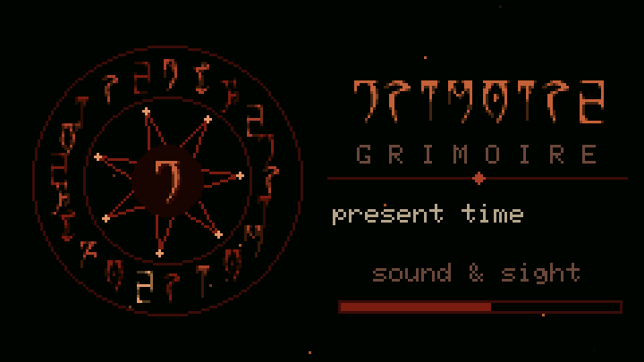
  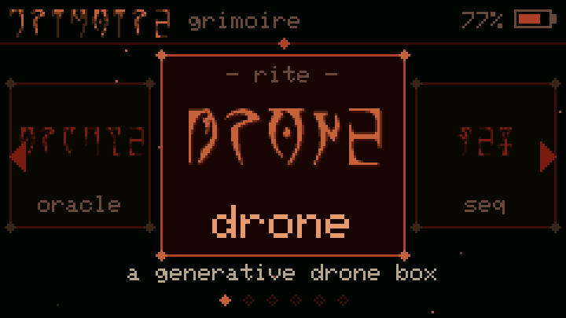
</p>

<p align="center">
  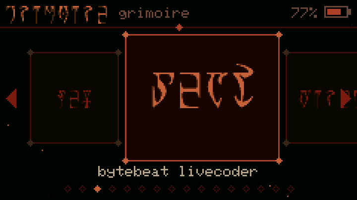<br>
  <em>Every rite rides the carousel in Daedric script; the one you land on dissolves into plain words.</em>
</p>

> **For authorized use only.** The networked and IR rites inspect and test
> networks and devices **you own or are explicitly permitted to test**. See
> [NOTICE.md](NOTICE.md). This project deliberately does **not** implement
> denial-of-service or phishing attacks.

---

## Rites

### ◈ sound
| | | |
|---|---|---|
| 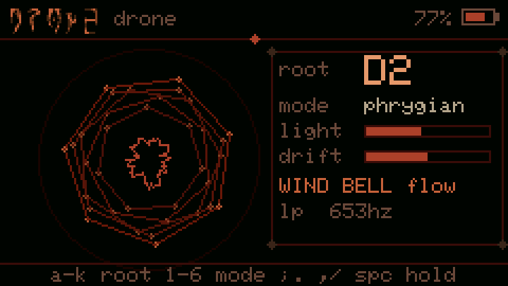 | 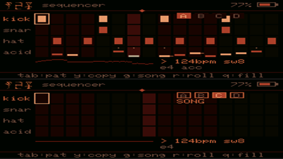 | 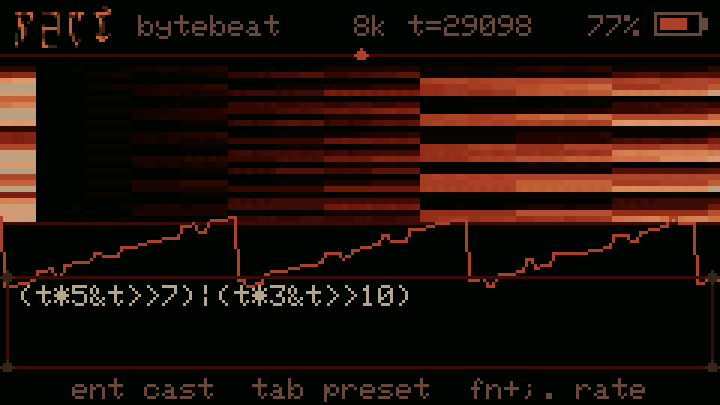 |
| **drone** — generative drone box: 5 drifting voices, resonant LP, wind, bells, dark delay | **seq** — groovebox: kick/snare/hat/acid, euclid fills, **4 pattern banks + song mode + save/load** | **beat** — bytebeat livecoder: type a C expression in `t`, hear it instantly |

### ◈ sight
| | | |
|---|---|---|
| 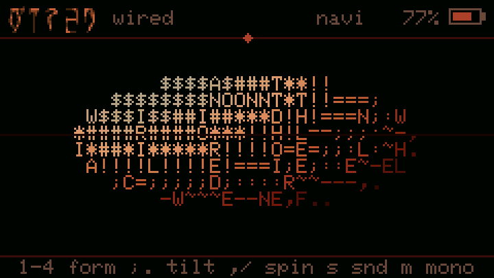 | 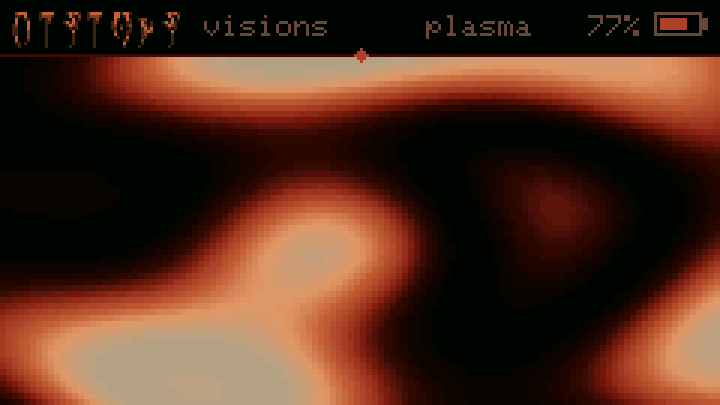 | 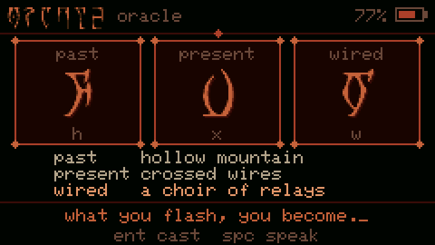 |
| **wired** — ASCII 3D: torus, navi sphere, wireframe solids, tunnel | **visions** — plasma, Oblivion gate, ash-fire, Daedric glyph-rain, heptagram kaleidoscope | **oracle** — cast three runes with bell chimes |

### ◈ the wired
| | | |
|---|---|---|
| 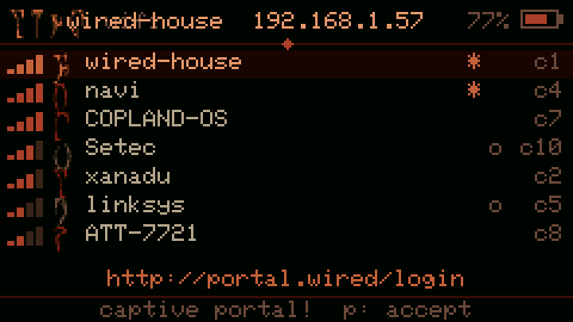 | 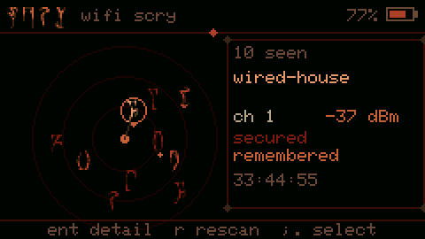 | 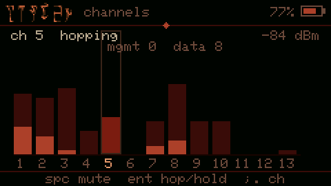 |
| **link** — join Wi-Fi (remembers networks); **captive-portal detect + click-through accept**; merges scans so flaky hotspots stick<br>*(2.4GHz only — set phone hotspots to 2.4GHz)* | **scry** — Wi-Fi networks as a constellation | **listen** — receive-only channel monitor you can hear |
| 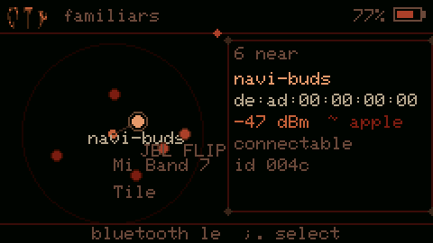 | 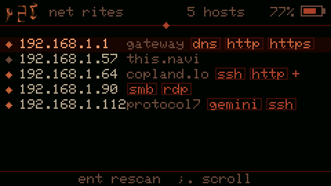 | 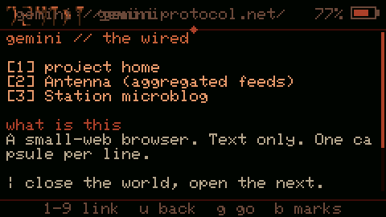 |
| **kin** — Bluetooth devices as drifting familiars | **net** — map the LAN: hosts, names, open ports | **gemini** — gemtext browser over TLS (+ posting) |
| 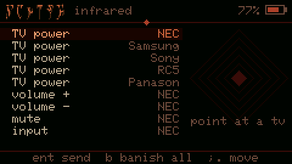 | | |
| **banish** — IR remote: TV power/volume across 5 protocols | | |

### ◈ wards
| | | |
|---|---|---|
| 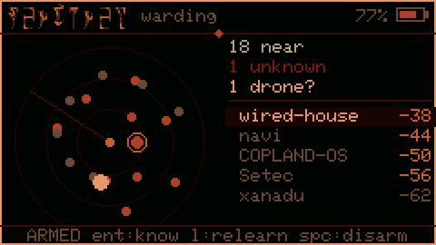 | 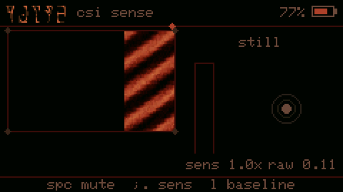 | 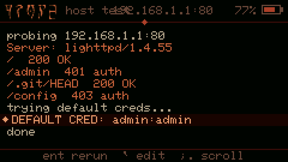 |
| **sentinel** — learns a baseline, then alarms on unknown devices; flags likely **drones** | **pulse** — Wi-Fi CSI motion / presence radar (experimental) | **probe** — active HTTP recon + default-credential check on an authorized host |

Everywhere: the top button (G0) or `` ` `` leaves a rite; twice in the menu returns
to the Launcher. `Fn` + `-`/`=` sets the volume. Menu and list navigation have
Kingdom-Hearts-style sound feedback.

---

## Build

```sh
pio run -e cardputer      # .pio/build/cardputer/firmware.bin -> install via the Launcher
pio run -e native         # desktop simulator (SDL2), 240x135 at 3x
.pio/build/native/program # laptop keys: arrows = Fn+;./  Alt = Fn  Esc = `
tools/shots.sh shots      # headless screenshots + WAVs of every rite
```

### Running in the simulator

The simulator plays audio through SDL, or to a file with `GRIM_WAV=out.wav`;
`GRIM_SCRIPT` drives it headless (see `src/hal_native.cpp`). A prebuilt device
image is in [`dist/`](dist/).

- Ctrl+R / Ctrl+L: rotate screen (swap width/height).
- Ctrl+1 through Ctrl+6: set window scale factor (1x–6x).

### Installing on the Cardputer

Copy `firmware.bin` to the SD card and install it from the Launcher, or push it
over USB serial while the Launcher is running (the Launcher grows the app
partition to fit). The ADV is a full wipe from the factory firmware — back up
first with `esptool read-flash 0 0x800000 backup.bin`.

## Development

### Layout
- `src/hal.*` — the hardware seam. `hal_device.cpp`: M5Cardputer, ES8311 codec,
  TCA8418 keyboard, 24 kHz audio with a UI-sfx overlay. `hal_native.cpp`: LovyanGFX
  SDL panel + SDL/WAV audio.
- `src/net.*` — Wi-Fi, BLE, promiscuous sniffing, LAN sweep, CSI, Gemini (TLS).
  `net_device.cpp` is real; `net_native.cpp` returns canned data for the sim.
- `src/theme.*`, `src/daedric_glyphs.h`, `src/dsp.h`, `src/uisfx.h` — skin, font,
  DSP kit, UI sounds.
- `src/apps/*.cpp` — one file per rite (`src/rite.h`).

### Working with `clangd`

For editors which rely on `clangd` you may need to generate a `compile_commands.json` to make your LSP happy:

```sh
pio run -e native -t compiledb
```

## Credits & license
MIT — see [LICENSE](LICENSE). Daedric font: **OMW Ayembedt** (SIL OFL 1.1,
`tools/OFL.txt`). Built on M5Cardputer / M5Unified / M5GFX and (for the sim)
LovyanGFX.
